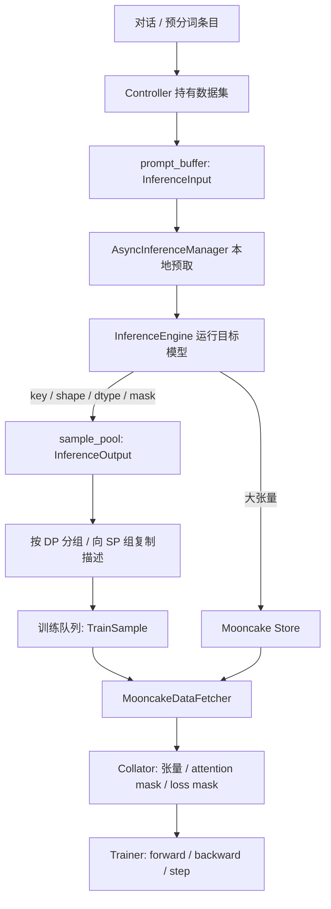

# 从一条对话到一个 optimizer step

[返回阅读路线](README.md)。本章把局部 tensor 操作放回跨进程系统中。先读懂“谁负责什么”，再读并发细节。

## 1. 不从类继承图入手，先跟一条样本走



这个图故意把大张量和描述它的元数据画成两路。先在 [utils/types.py](../../../torchspec/utils/types.py) 看 `InferenceOutput`：它有 `mooncake_key`、`tensor_shapes`、`tensor_dtypes`，不直接携带目标模型的所有激活。

再在 [training_controller.py](../../../torchspec/controller/training_controller.py) 跟踪四次转换：

1. `add_dataset` 将处理后的条目包装成 `InferenceInput`。
2. `get_prompts` 从控制器队列移交给推理管理器。
3. `push_inference_results` 根据 `data_id` 区分训练/评估，存放输出描述。
4. `_dispatch_to_queues` 生成训练端理解的 `TrainSample`。

这几步没有对目标大模型做前向。看见 `remote()` 不代表看见了 CUDA 计算；很多远程调用只是操作控制器中的 Python 队列。

## 2. 主程序为什么不直接构造两个模型

读 [train_entry.py](../../../torchspec/train_entry.py) 的 `train_async_no_generation`，按依赖关系归类：

| 阶段 | 依赖什么 | 产生什么 | 设计理由 |
|---|---|---|---|
| 解析草稿配置 | 模型配置/目标配置 | 明确算法与特征层要求 | 配置错误在占用 GPU 前失败 |
| 控制器加载数据 | tokenizer、数据文件 | 数据大小、可复用条目 | CPU 工作可与资源初始化重叠 |
| 创建 PG / Mooncake | 资源参数 | 设备位置、存储连接 | 训练和推理独立部署 |
| 算步数/词表 | 数据大小、token 频率 | LR 总步数、统一映射 | 所有 rank 必须同意这些约定 |
| 初始化 actors | 资源、配置、通信地址 | 已加载模型的进程 | 训练和推理加载可并行 |
| 接队列并启动 | 已初始化组件 | 持续的生产消费循环 | 从初始化切换到稳定运行 |

`_InitTimer` 特别区分任务总用时与 driver 等待时间。例如分词实际耗时 20 秒，其间 driver 用 15 秒建立资源，最后只等 5 秒；不能把两个阶段耗时简单相加当作初始化耗时。

函数名带 `no_generation` 是历史名称，当前内部也允许受限的 `train_with_decode` 路径。阅读时从条件分支和实际调用验证语义。

## 3. 数据正确性先于 GPU 性能

### 3.1 对话不是纯字符串

[data/dataset.py](../../../torchspec/data/dataset.py) 会规范化消息角色、提取图片/视频引用，再选模板 parser 或 renderer。多轮对话、工具调用、思考内容都可能改变监督区间。

`last_turn_loss_only="auto"` 要在格式化前分析原始消息，因为有的模板自动插入空 `<think></think>`。格式化后看见标签，不等于原始样本真的含有思考内容。这个决定还要记录到 metadata 中，以便媒体展开后重建 mask。

### 3.2 三条数据准备路径

| 路径 | 到引擎的主要输入 | 谁确定真实 token 序列 | mask 处理 |
|---|---|---|---|
| 普通预分词 | `input_ids` | 本地 tokenizer，媒体仍可能展开 | 纯文本沿用 packed mask |
| 延迟分词 | `formatted_prompt` | 推理引擎 | 根据引擎真实 ID 动态计算 |
| 已预分词语料 | 已有 ID 和 mask | 数据生产方 | 严格验证，不重新渲染/截断 |

“延迟分词”不代表这个数据 worker 完全不加载 tokenizer；当前 `_init_format_worker` 仍需它应用聊天模板，只是不在该阶段编码整条输入。

预分词语料若 2000 个 token 却配了总长 1999 的段长 mask，加载器会拒绝。直接 padding 一个零看似能运行，却可能隐藏生产方的错位，因此该入口选择严格校验。注意其他运行时 mask 恢复函数可能允许截断/补齐，二者面对的契约不同。

### 3.3 媒体为什么会打破旧位置

想象文本侧只有一个 `<image>` 占位符，引擎的视觉处理却将它展开成许多模型 token。它后面的 assistant 内容整体后移。旧 mask 仍按文本侧位置标一，就会监督到图片区域或漏掉回答。

因此正确路线是：先保存媒体引用和监督策略，待引擎确定真实 ID 后重新匹配 assistant 边界。这不是普通的末尾补 padding 问题，不能只把旧 mask 长度凑对。

### 3.4 组批有两个目标

`length_grouped_order` 在小组内排序，让相邻样本长度接近，减少 padding；控制器 `_partition_results` 则把较长样本优先分给目前 token 总量较小的 DP rank，减少同步训练的最慢 rank 等待。

例：四条长度 `[8,7,2,1]`、两个 DP rank、每人两条，贪心分成 `[8,1]` 和 `[7,2]`，双方总长都为 9。条数上限也必须保留，否则某个 rank 可能拿到三条，另一个只一条，队列消费协议就不匹配。

字符长度只是延迟分词时的粗略估计；它不保证跨语言 token 数的严格顺序。

## 4. 三个 batch，两个时间轴

在普通非 USP 路径中，设：

```text
micro_batch_size = 2
dp_size = 4
draft_accumulation_steps = 3
per_dp_rank_batch_size = 2
dispatch_batch_size = 2 × 4 = 8
global_batch_size = 8 × 3 = 24
```

控制器每次分发 8 条，各 rank 收到 2 条。每个 rank 累积处理三批后更新一次参数，一次全局更新处理 24 条。`completed_steps` 与 LR 调度都按这次参数更新计数，不按 3 次分发计数。

USP 时设 world=8、SP=4，得到 DP=2；当前入口要求 micro_batch=1 且 `per_dp_rank_batch_size=1`。同一个 DP 组的四张卡合作处理一个序列，所以累积 3 次只对应 `1×2×3=6` 条独立样本。

推理引擎还有自己的 `inference_batch_size`，它不需要与训练 micro-batch 相等：中间池把生产批次拆解成单样本描述，再重组成训练批次。这就是解耦带来的自由度。

## 5. 异步不等于每一处都无等待

[inference_manager.py](../../../torchspec/controller/inference_manager.py) 的 `run` 启动补货 task，同时执行提交/收集循环。

- 输入水位不足时一次抓取多条，减少 RPC 往返。
- `asyncio.create_task` 建立在途批次，远程 GPU 工作通过 `await` 等待。
- `FIRST_COMPLETED` 先处理已完成结果，慢引擎不阻止快引擎结果入池。
- 引擎轮询和总 semaphore 限制并发；当前并没有每引擎独立 semaphore，因此不是严格的逐引擎空闲调度器。

[controller/loop.py](../../../torchspec/controller/loop.py) 的训练部分仍按 step 同步等待所有 rank。这个同步是梯度通信的自然边界，背后的推理生产可以继续。

预取至少凑齐一次累积步数。若本次 step 的数据已齐而额外预取暂时缺货，主循环会开算当前 step，不会为了填满整个预取窗口一直闲等。

## 6. 背压：速度不匹配必须变成等待

假设目标端每秒产 100 条，训练端每秒消耗 60 条，持续 10 秒就多出约 400 条。每条若平均 50 MiB，积压约 20,000 MiB。只让生产更快，并不能提高训练消费速度。

背压指消费者积压时让生产者暂停提交。本实现管理器查询的主要阈值是待分发的样本条数；控制器另有训练池字节账本。不要把两个量混为一谈：

| 量 | 包含 | 不代表 |
|---|---|---|
| `get_pool_size` | 尚未分发的训练+评估条目 | 所有在途和已分发对象数 |
| `get_pool_bytes` | 尚未分发训练结果的估算字节 | 全部 Mooncake 实际内存占用 |
| 管理器 pending tasks | 已提交未收集的批次 | 引擎内部逐 token 调度状态 |
| store buffer 容量 | 某用途的预分配区 | 数据已被所有读者安全消费 |

因此样本池阈值是调度限流措施，不是严格物理内存保险箱。正在执行的任务仍可能完成并增加数据；删除策略、异步写池和接收缓冲还在存储层控制。

## 7. 评估、恢复和停机也是主路径的一部分

### 评估缓存

[eval.py](../../../torchspec/controller/eval.py) 先从独立评估队列把 teacher 特征保存到训练端 CPU 缓存，之后重复前向评估不必重新跑目标模型。小块提交、消费后再补充，避免整份验证集挤满 Mooncake。所有 rank 缓存都命中才算整体命中。

缓存 key 使用部分数据/模型配置字段，不能视为完整内容哈希。更换底层权重而保留同一路径时，需理解缓存命名的边界。

### 恢复

恢复到 optimizer 第 N 步不等于恢复了所有异步输入/输出队列。当前控制器用 seed+epoch 重建数据顺序，再按已完成步数估计 skip；在途尾部可能重放或丢失，因此只声明尽力恢复数据进度。

`continual_training` 又是另一种语义：从权重开启新优化过程，与完整恢复优化器、LR、RNG 不同，见 [训练教程](training.md)。

### 停机

`run_training_loop` 用 `try/finally` 调用 `_safe_training_cleanup`。先停止推理管理器，收尾在途工作，再关引擎和存储主进程。队列上的 `None` 是消费者结束哨兵，不是正常训练样本。

普通单批异常会被管理器过滤；actor 死亡会设置致命错误并让训练分发失败。阅读故障日志时先分辨二者，不能把“没有新样本”都归因于 GPU 算慢。

## 8. Ray 资源不是 CUDA 显存隔离

[placement_group.py](../../../torchspec/ray/placement_group.py) 一次预留 bundle，探测实际位置后稳定排序；[train_group.py](../../../torchspec/ray/train_group.py) 用排序结果创建 rank；[ray_actor.py](../../../torchspec/ray/ray_actor.py) 将物理卡号映射到进程可见 CUDA 编号。

例如物理卡 5 被单独暴露给进程，进程内可能称它为 `cuda:0`。Ray 的 `num_gpus=0.4` 是逻辑调度配额，并不会自动把显存切成 40%。共卡作业的真实显存压力仍需各模型自己控制。

PyTorch process group 用于 all-reduce 等集合通信，Ray placement group 用于资源位置。名字都带 group，但控制的东西不同。

## 9. 离线回放为什么仍然值得沿原流水线读

[offline/generate.py](../../../torchspec/offline/generate.py) 将正常消费者换成磁盘保存 actor；每条描述下载张量并保存为 `.pt`，同时维护清单和 norm 元数据。之后 `offline_replay_engine` 把磁盘记录重新发布到 Mooncake，训练端继续用原队列/fetcher。

它减少反复运行 teacher 的成本，代价是磁盘空间和 I/O。不是把 Ray/Mooncake 全部移除后的一个全新训练器。当前物化保存器不支持 vLLM PP 分层 manifest，代码明确拒绝，而不是假装 base key 下有完整样本。

## 10. 自测与定位练习

1. **某次 dispatch 已减去池字节，但 store 仍占内存，是否一定泄漏？** 不一定。先检查训练队列、读取完成、GPU clone 和延迟删除；池出账不等于对象删除。
2. **两个 SP rank 消费同一个队列就会读到相同样本吗？** 不会。普通队列 get 会移走条目；当前控制器为各 rank 队列分别放入同一描述。
3. **推理每批 8 条、训练每 rank 2 条会冲突吗？** 不必。样本池按条目重组；只要分发与消费者数量一致即可。
4. **最后一轮验证只剩 3 条但 DP=4，会怎样？** 当前控制器加载验证集时截断到 DP 整数倍，避免不完整评估批次；不是自动补一个样本。
5. **如何读一个挂住的训练？** 顺序观察输入缓冲→pending task→sample_pool→dispatch→训练 rank；找到最后一个有进展的边界，再进对应组件，而非先阅读所有 attention kernel。
